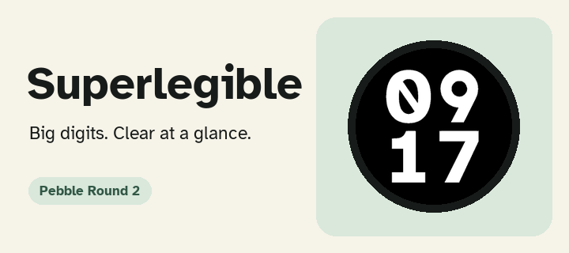

# Superlegible

A Pebble watchface that fills the display with large, high-contrast digits set in Atkinson Hyperlegible.

**[Get Superlegible on the Pebble App Store](https://apps.repebble.com/95524892423d4e7f95f28b15)** · [Supported watches](#supported-watches) · [Build from source](#build-from-source)



## Install

1. Open the [Pebble App Store listing](https://apps.repebble.com/95524892423d4e7f95f28b15) and choose **Add to My Faces**.
2. In the Pebble phone app, select **Superlegible** from your watchface library.

For manual installation, download `Superlegible-1.3.0.pbw` from the [GitHub 1.3.0 release](https://github.com/dan-hart/pebble-superlegible-watchface/releases/tag/v1.3.0) or choose **Download PBW** on the Pebble App Store page. Both downloads contain the same watchface.

The Pebble App Store edition has a new app ID and installs alongside earlier builds that use the original ID. If you switch editions, set your colors again in the new one.

## Set your colors

Open the gear next to **Superlegible** in the Pebble phone app. Choose **Digits** and **Background**, then tap **Save**. Use different colors with enough contrast to read at a glance.

- **Color watches** offer the Pebble palette. Time 2 starts with orange digits on navy. Other models start with white digits on black.
- **Black-and-white watches** support white on black or black on white.

The watch saves your palette locally and follows its own 12- or 24-hour time setting. In 12-hour mode, single-digit hours have no leading zero. The display updates once a minute.

## Supported watches

| Watch | SDK target | Display |
| --- | --- | --- |
| Original Pebble and Pebble Steel | `aplite` | 144 × 168, monochrome |
| Pebble Time and Time Steel | `basalt` | 144 × 168, color |
| Pebble Time Round | `chalk` | 180 × 180, round color |
| Pebble 2 and Pebble 2 Duo | `diorite` | 144 × 168, monochrome |
| Pebble Time 2 | `emery` | 200 × 228, color |
| Pebble Round 2 | `gabbro` | 260 × 260, round color |

Pebble 2 Duo runs the compatible `diorite` binary. The package includes native builds for Time 2 and Round 2.

## What's new in 1.3.0

- The Pebble App Store listing has custom icons and a banner for each supported target.
- The phone app now lets you choose digit and background colors for each watch.
- Pebble Time 2 uses display-sized digit bitmaps with a 10-pixel inset.
- Pebble Round 2 uses upright digits with room around the bezel. A single-digit hour lines up with the right-hand minute digit.

## Build from source

Install Node.js with npm, Python 3.10–3.13, and [uv](https://docs.astral.sh/uv/getting-started/installation/). Follow the [Pebble SDK setup guide](https://developer.repebble.com/sdk/) for your operating system. Version 1.3.0 was built with SDK 4.44, which requires `pebble-tool` 5.1.0 or later.

```bash
uv tool install --python 3.12 'pebble-tool>=5.1.0'
pebble sdk install 4.44

git clone https://github.com/dan-hart/pebble-superlegible-watchface.git
cd pebble-superlegible-watchface
npm ci
pebble build
```

The SDK writes the compiled `.pbw` to `build/`. Use the target codes above to run the watchface on different emulator displays.

```bash
pebble install --emulator gabbro
```

For a physical watch, enable **Dev Connection** in the Pebble phone app and use the [SDK's device installation instructions](https://developer.repebble.com/sdk/#next-steps).

### Run the tests

```bash
python3 -m unittest discover -s tests
node --test tests/phone-settings.test.js
```

Run the Node test after `pebble build` so it exercises the bundled PebbleKit JS. The Python tests check the Time 2 and Round 2 digit layouts. Before submitting visual changes, check both time formats and a custom palette on the platforms you changed.

### Update the Pebble App Store release

The [Pebble App Store listing](https://apps.repebble.com/95524892423d4e7f95f28b15) uses UUID `3e371e59-7411-42f6-b6b4-25b055e37ffa`. The repo's default `pebble.uuid` in [package.json](package.json) identifies the earlier edition.

For a store release, use a separate checkout. Set `pebble.uuid` to the store UUID and set the package version to a version Pebble has never received for this listing. Build, confirm the PBW includes all six targets, then open **New Release** on the existing listing in the [Pebble Developer Dashboard](https://developer.repebble.com/dashboard).

## Project files

| Path | Contents |
| --- | --- |
| [src/main.c](src/main.c) | Digit layout, clock updates, and on-watch palette storage |
| [src/pkjs/](src/pkjs/) | Pebble phone settings and palette sync |
| [resources/](resources/) | Atkinson Hyperlegible fonts and pre-rendered digit bitmaps |
| [store-assets/](store-assets/) | Listing artwork and screenshots |
| [tools/](tools/README.md) | Screenshot, banner, and digit-generation utilities |
| [Design/](Design/) | GIMP source files and mockups |

## Contribute

Install the repository's security hooks with `./scripts/install-hooks.sh`. See the [security policy](SECURITY.md) for details. When reporting a display or color issue, include your watch model, time format, and a screenshot if you can.

[Report an issue](https://github.com/dan-hart/pebble-superlegible-watchface/issues) · [Support the project](https://buymeacoffee.com/codedbydan)

Superlegible is developed by Dan Hart and licensed under the [GNU GPL v3](LICENSE). [Atkinson Hyperlegible](https://brailleinstitute.org/freefont) is designed by Braille Institute and distributed under the [SIL Open Font License](OFL.txt).
